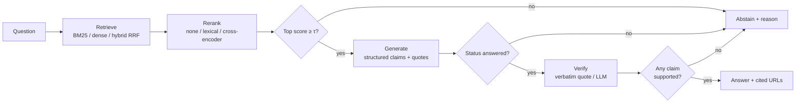

# 🔎 Grounded RAG: Knowing When Not to Answer

> A documentation Q&A assistant that cites every claim and declines when the documents do not support an answer.

[](https://github.com/MAJIIDMN/RAG-say-no/actions/workflows/ci.yml)


This repo is also the `ragkit` foundation for the next RAG projects: generic code lives in
`src/ragkit/`, and everything project-specific lives in `configs/`, `data/`, `evals/` and `scripts/`
(see [docs/REUSE.md](docs/REUSE.md)).

**Demo:** TBD. `docs/images/demo.gif` gets recorded once variant E006 runs on the FastAPI docs.

## Problem

A typical RAG system still answers when the retrieved passages do not contain the answer. The answer
sounds confident and is made up. On technical documentation that is worse than "I don't know",
because people copy the code. This project measures two things at once: how often the system answers
a question the documents cannot answer, and how often it refuses a question they can.

A real example from the baseline without abstention on the toy corpus. The corpus never mentions
RabbitMQ, yet the baseline answers:

```text
$ ragkit ask "Can Quokka use RabbitMQ as a broker?" -c configs/toy.yaml
A worker can listen on several queues by listing them, for example `quokka worker emails reports`.
  [1] Workers https://quokka.example/docs/workers/
```

## Results

FastAPI eval set: TBD (target 150–300 questions, 25–30% unanswerable; protocol in
[docs/architecture.md](docs/architecture.md#eval-protocol)). Every cell below will come from
`make ablation` and `make report`; none has been measured yet.

| Variant | Context recall@5 | Faithfulness | Correctness | Abstention F1 | Over-refusal | p95 latency |
|---|---|---|---|---|---|---|
| Dense only (E002) | TBD | TBD | TBD | – | – | TBD |
| + BM25 (RRF) (E003) | TBD | TBD | TBD | – | – | TBD |
| + Reranker (E004) | TBD | TBD | TBD | – | – | TBD |
| + Abstention (E005) | TBD | TBD | TBD | TBD | TBD | TBD |
| + Claim verification (E006) | TBD | TBD | TBD | TBD | TBD | TBD |

Coverage vs accuracy curve (`docs/images/coverage_accuracy.png`): TBD, made with
`ragkit plot <run-dir>` from the E005 run.

**Smoke test on sample data, not a final result.** The toy corpus has 3 fictional pages; its `test`
split has 6 questions, 2 of them unanswerable:

| Config | Coverage | Correctness | Accuracy (answered) | Over-refusal | Unanswerable answered | CRAG score |
|---|---|---|---|---|---|---|
| `toy`, score gate off (`make eval`) | 1.000 | 0.750 | 0.750 | 0.000 | 1.000 | 0.000 |
| `toy-tuned`, threshold 0.625 picked on `calib` (`make tune`) | 0.333 | 0.500 | 1.000 | 0.500 | 0.000 | 0.667 |

These rows only show that the pipeline, the metrics and calib-only tuning run from a clean clone.
The trade-off already shows: the gate stops both made-up answers and also refuses half of the
answerable questions.

## Architecture



- **Retrieve:** BM25 (`bm25s`), dense (bge-small-en-v1.5), or both fused with Reciprocal Rank Fusion
  (k = 60).
- **Rerank:** cross-encoder ms-marco-MiniLM-L6-v2 with a sigmoid score in [0, 1], so the score can
  serve as a threshold.
- **Abstention gates:** a rerank score threshold picked on `calib`, an optional LLM
  context-sufficiency check, and the generator's `insufficient_context` status.
- **Generate:** the LLM returns structured JSON with claims, passage IDs and quotes. An extractive
  baseline without an LLM covers CI.
- **Verify:** claims whose quote is not verbatim in the cited passage are dropped.

Each stage is picked in config (`{impl: name, ...params}`), not by editing the pipeline. The design
decisions and their alternatives are in [docs/architecture.md](docs/architecture.md).

## Contents

[Quickstart](#quickstart) · [Configuration](#configuration) · [Data](#data) ·
[Evaluation](#evaluation) · [Repo layout](#repo-layout) · [Development](#development) ·
[Technical decisions](#technical-decisions) · [Limitations](#limitations) · [Roadmap](#roadmap)

## Quickstart

Requirements: Python 3.13 and [uv](https://docs.astral.sh/uv/) 0.13 or newer. Docker is optional.
The steps below need no GPU, API key or model download.

```bash
git clone git@github.com:MAJIIDMN/RAG-say-no.git && cd RAG-say-no
make setup        # uv sync with the llm, evals and api extras; copies .env.example to .env
make lint test    # ruff + pytest
make eval         # ingest the toy corpus, then evaluate the test split
```

Trimmed output from a clean clone:

```text
All checks passed!
69 files already formatted
110 passed, 2 skipped in 3.36s
...
  "recall@5": 1.0,
  "unanswerable_answered_rate": 1.0,
  "citation_precision": 1.0,
Run: runs/20261114-100132_toy_test
```

The `ragkit` command lives in the venv. Activate it first, because `uv run` without `--no-sync`
re-syncs and drops the extras. Then ask a question or start the API:

```bash
source .venv/bin/activate
ragkit ask "How many times is a failed job retried by default?" -c configs/toy.yaml
make serve                  # POST /ask, GET /health on http://127.0.0.1:8000
docker compose up --build   # CPU image, toy config by default, port 8000
```

```text
A failed job is retried up to 3 times by default.
  [1] Background Jobs https://quokka.example/docs/background-jobs/
      "A failed job is retried up to 3 times by default."
```

For the FastAPI docs and real models:

```bash
make setup-ml     # + sentence-transformers and CPU torch
make data         # sparse clone of FastAPI at the pinned commit, then preprocess
# set LLM_MODEL and LLM_API_KEY in .env, then:
make ablation SPLIT=test
make report
```

## Configuration

**Environment (`.env`).** The LLM provider is not locked in. `openai_compatible` targets endpoints
that follow the OpenAI API (e.g. OpenRouter, vLLM, Ollama), and `anthropic` uses the Anthropic SDK.
Both are tested only with fake clients so far; real providers get tried in E002.

| Variable | Purpose |
|---|---|
| `LLM_PROVIDER` | `openai_compatible`, `anthropic` or `fake` |
| `LLM_MODEL`, `LLM_BASE_URL`, `LLM_API_KEY` | Generator model and endpoint |
| `LLM_STRUCTURED_MODES` | Structured output fallback order: `json_schema,json_object,text` |
| `LLM_INPUT_PRICE_PER_MTOK`, `LLM_OUTPUT_PRICE_PER_MTOK` | Price per million tokens, for `$/query` in reports |
| `JUDGE_*` | Same as `LLM_*` for the judge; empty means inherit from `LLM_*` |
| `HF_TOKEN` | Optional, for Hugging Face downloads |

**YAML configs.** `configs/base.yaml` holds the defaults; a variant uses `extends` and lists only
what it changes. When a variant switches a stage's `impl`, the parent's params for that stage are
dropped.

```yaml
# configs/experiments/E004_rerank.yaml
extends: E003_hybrid.yaml
name: E004_rerank
reranker: {impl: cross_encoder}
```

One-off overrides: `ragkit eval -c configs/toy.yaml -e evals/datasets/toy.jsonl -o retrieval.context_size=8`.

| Stage | Built-in implementations |
|---|---|
| `chunker` | `markdown_heading`, `fixed` |
| `embedder` | `hashing` (offline), `sentence_transformers` |
| `retriever` | `bm25`, `dense`, `hybrid` |
| `reranker` | `none`, `lexical`, `cross_encoder` |
| `generator` | `extractive`, `llm` (`allow_abstain: false` for the naive prompt) |
| `verifier` | `none`, `quote`, `llm` |
| `judge` | `lexical` (offline), `llm` |

Project-specific stages register from your own package through `plugins: [my_project.stages]`.

## Data

| Corpus | Source | License | Size |
|---|---|---|---|
| Toy (`data/toy/`) | Fictional docs for a library called "Quokka", written for this repo | MIT (this repo) | 3 pages, 3 chunks |
| FastAPI (`data/processed/fastapi/`) | `docs/en/docs` at github.com/fastapi/fastapi, commit `315f093f` | MIT | 124 pages, 1,004 chunks (`markdown_heading`, 400 tokens) |

`make data` runs `scripts/prepare_fastapi_docs.py`: a sparse clone, the `{* ... *}` code samples
inlined, HTML and anchors removed, `title` and `url` front matter written. The changelog,
`reference/` and community pages are skipped (34 files). Neither raw nor processed data is
committed. Details in [data/README.md](data/README.md).

Eval sets are JSONL with `dev` (prompts and chunking), `calib` (threshold only) and `test` (reporting
only) splits. Questions from the same page always share a split. Relevance comes from `evidence`,
verbatim spans of the documents, so an eval set stays valid when chunking changes. Check one with:

```bash
ragkit evalset check -c configs/toy.yaml -e evals/datasets/toy.jsonl
```

## Evaluation

| Metric | Definition |
|---|---|
| Recall@k, MRR | Share of gold `evidence` spans in the top-k candidates; rank of the first hit |
| Context recall | Share of gold `evidence` spans that reach the generator |
| Faithfulness | Share of claims supported by the passages they cite, per the LLM judge |
| Citation precision | Share of quotes found verbatim in the cited passage |
| Correctness | Answerable questions that got a correct answer, per the judge; a refusal counts as a miss |
| Accuracy (answered) | Correct answers per the judge, among answerable questions that got an answer |
| Coverage | Share of all questions that got an answer |
| Abstention P/R/F1 | The positive class is "should refuse" |
| Over-refusal | Answerable questions that were refused |
| Unanswerable answered | Unanswerable questions that still got an answer (hallucination risk) |
| CRAG score | Correct answer or correct refusal +1, refusing an answerable question 0, wrong or made-up answer −1 |
| AURC | Area under the risk–coverage curve, ordered by confidence |

Each run writes `runs/<time>_<config>_<split>/` with `config.yaml`, `predictions.jsonl`,
`metrics.json` (including git commit, corpus digest and source, prompt version and model) and,
when the score gate is off, `curve.json`. `ragkit tune` reads only the `calib` split, replays the score gate at every threshold
and writes `configs/tuned/<config>.yaml`. `make report` builds the ablation table from the newest
run per config. The `lexical` judge is an offline proxy only; LLM judge numbers get reported only
after an audit against 50 hand labels.

## Repo layout

```text
src/ragkit/          generic, reusable code
  core/              schemas, a Protocol per stage, registries
  ingest/ index/     loaders, chunkers, embedders, numpy index
  retrieval/ rerank/ BM25, dense, hybrid RRF; rerankers
  llm/               openai_compatible, anthropic and fake clients
  generation/        prompts and generators
  abstention/        abstention gates
  verification/      quote and claim verification
  eval/              dataset, metrics, judges, runner, tuning, report
  pipeline.py cli.py api.py
configs/             base.yaml, toy.yaml, experiments/E001–E007
data/                toy corpus (committed); raw/ and processed/ (not committed)
evals/datasets/      JSONL eval sets
scripts/             FastAPI-specific preprocessing
tests/               unit/ and integration/
docs/                architecture and reuse guide
```

## Development

```bash
make hooks        # install pre-commit (ruff, YAML/TOML checks, private key detection)
make lint test
make test-slow    # real embedding and reranker models (needs setup-ml, ~200 MB download once)
```

Coverage is 93% (`pytest --cov=ragkit`; 100 tests pass, 2 are skipped because they need
`RAGKIT_SLOW=1`).

To add a stage implementation, write a class that satisfies the `Protocol` in
`src/ragkit/core/stages.py`, register it with the registry decorator, and pick it in config. A full,
tested example is in [docs/REUSE.md](docs/REUSE.md).

## Technical decisions

[docs/architecture.md](docs/architecture.md) explains the pipeline, the seams and each default with
the alternative it beat: an own package over LangChain/LlamaIndex, brute-force numpy over a vector
DB, heading-aware chunking, small CPU models, RRF with k = 60, layered abstention, verbatim quote
checks, a thin structured-output client over LiteLLM/instructor, and own metrics over Ragas/DeepEval.

## Limitations

- The FastAPI eval set does not exist yet, so there are no results. The toy eval set has 18
  questions and shows only that the code works.
- The extractive baseline picks the sentence with the most query words. On the toy set it answers
  the timeout question with the retry sentence because the scores tie, and it answers unanswerable
  questions.
- The `lexical` reranker score is a weak confidence signal: on the toy set the threshold from
  `calib` refuses half of the answerable `test` questions. The score gate is meant for cross-encoder
  scores, which are not measured yet.
- The `lexical` judge is a proxy; the LLM judge has not been audited against hand labels.
- Brute-force numpy index with a single vector store adapter.
- English documentation and single-turn Q&A only.

## Roadmap

- [x] Generic pipeline with stages swapped through config
- [x] Offline baseline, toy eval set, metrics, calib-only tuning, ablation table
- [x] FastAPI docs preprocessing at a pinned commit
- [x] CLI, FastAPI service, Docker, CI
- [ ] FastAPI eval set of 150–300 questions (dev/calib/test)
- [ ] E001–E004: baseline, dense + LLM, hybrid, reranker
- [ ] E005: abstention with the threshold from `calib`; E007: fixed chunking
- [ ] E006: claim verification; audit the LLM judge on 50 hand labels
- [ ] Eval report, demo GIF, case study

## Related projects

- `evals-llmops/eval-harness-ci-gate`: plugs into this repo as a CI gate on eval metrics.
- `rag/visual-document-rag`, `rag/graphrag-hybrid-search`, `rag/indonesian-multilingual-rag`:
  planned to build on `ragkit`.

## License

Code is MIT licensed ([LICENSE](LICENSE)). The FastAPI documentation is MIT licensed and is not
included in the repo. Default models: BAAI/bge-small-en-v1.5 (MIT) and
cross-encoder/ms-marco-MiniLM-L6-v2 (Apache-2.0), downloaded on first use.

## Acknowledgements

- Cormack, Clarke and Büttcher (2009), *Reciprocal Rank Fusion outperforms Condorcet and individual
  Rank Learning Methods*.
- Yang et al. (2024), *CRAG: Comprehensive RAG Benchmark*, for the 1/0/−1 scoring scheme.
- Geifman and El-Yaniv (2017), *Selective Classification for Deep Neural Networks*, for the
  risk–coverage curve.

## Contact

GitHub: [MAJIIDMN](https://github.com/MAJIIDMN)
